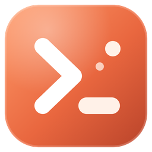
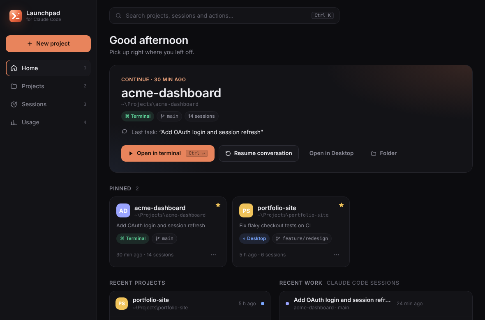
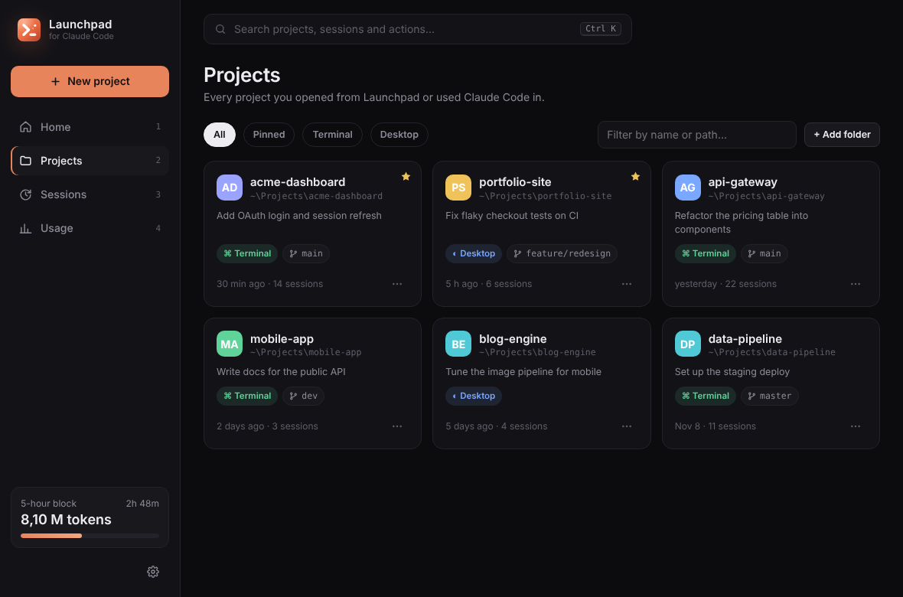
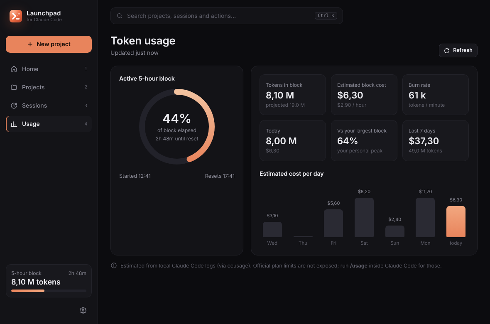

<p align="center"></p>

<h1 align="center">Launchpad for Claude Code</h1>

<p align="center">A small desktop launcher for Claude Code: jump back into your last project in one click, resume past conversations, and keep an eye on token usage.</p>

<p align="center"></p>

> **Independent project.** Launchpad is not affiliated with, endorsed by, or supported by Anthropic. "Claude" and "Claude Code" are trademarks of Anthropic.

## Features

- **Continue where you left off.** The home screen shows your last project, its git branch and your last task. One button reopens it, in the terminal or in Claude Desktop, the same way you used last time.
- **Recent work.** Launchpad reads your local Claude Code session history, so every project you used Claude Code in shows up automatically, with the first prompt of each conversation as its title.
- **Resume any conversation.** Click a session to reopen it with `claude --resume`, or use *Resume conversation* to continue the latest one.
- **New projects in seconds.** Pick a name and a folder; Launchpad can run `git init`, add a starter `CLAUDE.md` and open it straight away.
- **Pins, search and shortcuts.** Pin favourites, filter by mode, and use the command palette (<kbd>Ctrl</kbd>+<kbd>K</kbd>) to open anything from the keyboard.
- **Token usage.** Tokens and estimated cost in the current 5-hour block, burn rate, time until reset, and a 7-day chart.

<p align="center">
  
  
</p>

## Requirements

- **Windows 10 or 11.** macOS and Linux code paths exist but are untested.
- **Python 3.9 or newer** from [python.org](https://www.python.org/downloads/). Tick *Add python.exe to PATH* during setup.
- **[Claude Code](https://docs.claude.com/en/docs/claude-code/overview)**, with the `claude` command on your PATH.
- **Node.js (optional).** Only the token usage panel needs it.
- **Microsoft Edge WebView2.** Windows 11 already includes it.

## Install

1. Download this repository: **Code → Download ZIP**, then extract it, or run `git clone https://github.com/seandevai/launchpad-for-claude-code`.
2. Double-click **`install.bat`**.

The installer:
- installs the one Python dependency (`pywebview`);
- creates a Desktop and a Start menu shortcut;
- assigns the hotkey <kbd>Ctrl</kbd>+<kbd>Alt</kbd>+<kbd>L</kbd>.

To use a different hotkey, run:

```bat
install.bat -Hotkey "Ctrl+Alt+K"
```

To uninstall, run **`uninstall.bat`**. It removes the shortcuts and keeps your settings, unless you pass `-RemoveData`.

## Keyboard shortcuts

| Keys | Action |
| --- | --- |
| <kbd>Ctrl</kbd>+<kbd>K</kbd> | Search projects, sessions and actions |
| <kbd>Ctrl</kbd>+<kbd>Enter</kbd> | Open the last project |
| <kbd>Ctrl</kbd>+<kbd>N</kbd> | New project |
| <kbd>1</kbd>–<kbd>4</kbd> | Home, Projects, Sessions, Usage |
| Right-click a project | More actions: open mode, pin, rename, hide |

Launching Launchpad again while it is already open brings the existing window to the front.

## How it works, and your privacy

- **Projects and sessions** come from two places: Claude Code's local history in `~/.claude/projects` (read-only), and Launchpad's own list in `~/.launchpad-cc/state.json`. Launchpad never modifies Claude Code's files.
- **Opening a project** starts `claude` in a new terminal, inside that folder. Session IDs are validated as UUIDs before they are passed to `claude --resume`. Folder paths are passed as a working directory, never inserted into a shell command.
- **Claude Desktop** has no command-line option to open a folder. Launchpad opens the app and copies the project path to your clipboard.
- **Token usage** comes from [ccusage](https://github.com/ryoppippi/ccusage), which reads the same local logs. The version is pinned (`ccusage@20.0.51`) so that a future npm release never runs automatically. These figures are estimates: official plan limits are not exposed, so run `/usage` inside Claude Code for those.
- **Network.** Launchpad makes no network requests of its own and sends no telemetry. The only download is the pinned `ccusage` package, fetched once by `npx`. The interface runs with a Content Security Policy that blocks remote content.
- **Logs** stay on your machine, in `~/.launchpad-cc/` (`launchpad.log`, `stderr.log`, `install.log`).

## Troubleshooting

- **The window does not open.** Check `%USERPROFILE%\.launchpad-cc\launchpad.log` and `stderr.log`. Run `python launchpad.py --debug` to open the developer tools.
- **"Open in terminal" does nothing.** Make sure `claude` works in a new Command Prompt.
- **The usage panel shows an error.** Install Node.js, then press *Refresh*. The first run downloads ccusage and can take up to a minute.
- **Preview the UI without Python.** Open `ui.html?demo` in a browser. It uses fictional sample data.

## Contributing

Issues and pull requests are welcome. Please read [SECURITY.md](SECURITY.md) before reporting a vulnerability.

## License

[GPL-3.0](LICENSE). You may use, study, change and redistribute this software. If you distribute a modified version, you must release its source under the same license.
